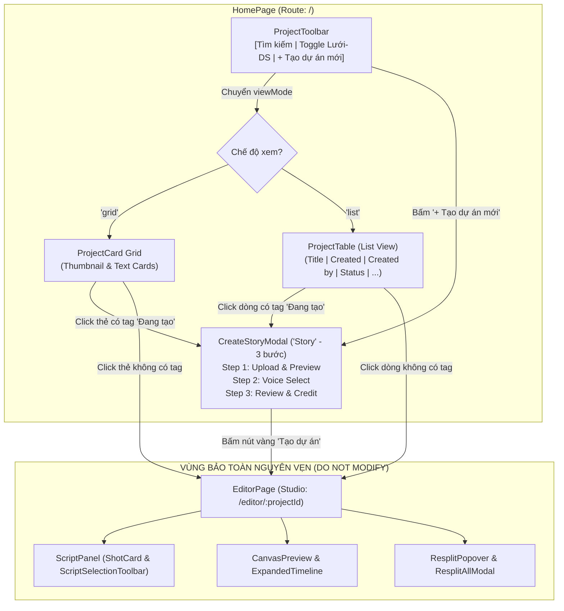

# Thiết Kế Giao Diện: Màn Hình Ban Đầu (Trang Chủ) & Modal Khởi Tạo / Import Story

Tài liệu đặc tả kiến trúc giao diện, luồng tương tác và kế hoạch triển khai Frontend cho 2 thành phần chính:
1. **Màn hình ban đầu (Trang chủ / Project Dashboard):** Quản lý danh sách dự án Story2Video (hỗ trợ chuyển đổi linh hoạt giữa 2 chế độ: Lưới thẻ và Bảng danh sách).
2. **Modal Khởi tạo & Import Story (Creation & Import Modal - Tên: Story):** Trình hướng dẫn 3 bước (Stepper) đưa kịch bản sách vào Studio.

---

## PHẦN 1: MÔ TẢ GIAO DIỆN & HÀNH VI

### 1. Màn hình ban đầu (Trang chủ / Project Dashboard)

#### 1.1. Bố cục tổng thể & Thanh công cụ (Toolbar)
* **Header trang chủ (`HomeHeader`):**
  * Nằm riêng trên đầu trang chủ `HomePage` (không ghim cứng vào `MainLayout` để tránh làm vướng trang Studio).
  * Bên trái: Logo + Tiêu đề thương hiệu **`Story2Video`** (font bold, hiện đại).
  * Bên phải: Thông tin tài khoản người dùng (`My Anh 👤`) hoặc số dư điểm. Không dùng thanh điều hướng demo `Home | Project | Editor`.
* **Thanh công cụ trang chủ (Project Toolbar):**
  * Tiêu đề danh mục: `Dự án của tôi`.
  * Nút hành động chính bên phải: **`[ + Tạo dự án mới ]`** (Màu vàng nổi bật, click mở Modal `Story`).
  * Thanh tìm kiếm: Ô `[ 🔍 Tìm kiếm dự án... ]` (đã bỏ dropdown bộ lọc).
  * Nút chuyển đổi chế độ xem: **`[ ⊞ Lưới ]`** và **`[ ☰ Danh sách ]`**.

---

#### 1.2. Chế độ hiển thị 1: Lưới thẻ (Grid View)

```
+----------------------------------------------------------------------------------------------------+
|  Story2Video                                                      [ User: My Anh 👤 ]               |
+----------------------------------------------------------------------------------------------------+
|  Dự án của tôi                                                                [ + Tạo dự án mới ]  |
|  [ 🔍 Tìm kiếm dự án...                                          ]             [ ⊞ Lưới | ☰ DS ]   |
+----------------------------------------------------------------------------------------------------+
|                                                                                                    |
|  +------------------------+  +------------------------+  +------------------------+                |
|  | [    ẢNH THUMBNAIL   ] |  | [    ẢNH THUMBNAIL   ] |  | +--------------------+ |                |
|  |                        |  |                        |  | | Introduction:      | | (Text Preview) |
|  | ● Đang tạo       |  | ● Đang tạo       |  | | "Xin chào tất cả..."| |                |
|  +------------------------+  +------------------------+  | +--------------------+ |                |
|  | Căn cứ kết quả giám... |  | Diễn viên Thúy Diễm... |  | ● Đang tạo       |                |
|  | 40m ago · My Anh        |  | 2h ago · My Anh         |  +------------------------+                |
|  +------------------------+  +------------------------+  | Dưới sự thao túng...   |                |
|                                                          | 2d ago · My Anh         |                |
|                                                          +------------------------+                |
+----------------------------------------------------------------------------------------------------+
```

* **Hai dạng thẻ dự án trong Lưới:**
  1. **Thẻ Thumbnail Video/Ảnh:** Hình ảnh đại diện tỷ lệ 16:9, góc dưới có badge chấm xanh `● Đang tạo`.
  2. **Thẻ Text Preview (Kịch bản văn bản):** Khung trang giấy xem trước 3–4 dòng văn bản đầu (`"Introduction: Xin chào tất cả mọi người..."`), góc dưới có badge `● Đang tạo`.
* **Chân thẻ:** Tiêu đề dự án (cắt ngắn 1 dòng `...`) và metadata (`40 minutes ago · My Anh`).
* **Hành vi click thẻ (Card Click):**
  * **Nếu thẻ có tag `● Đang tạo`:** Nhấp vào sẽ **mở lại Modal Khởi tạo & Import Story (`Story`)** với dữ liệu bản thảo cũ để người dùng tiếp tục thiết lập.
  * **Nếu thẻ không có tag (để trống):** Nhấp vào sẽ mở thẳng vào trang Studio (`/editor/:projectId`).

---

#### 1.3. Chế độ hiển thị 2: Bảng danh sách (List View - Ảnh mới đính kèm)

Khi người dùng chuyển sang chế độ `[ ☰ Danh sách ]`, giao diện chuyển thành bảng table phẳng, gọn gàng và dễ đối chiếu nhiều dự án:

```
+----------------------------------------------------------------------------------------------------+
|  Title                                   Created          Created by     Status                    |
+----------------------------------------------------------------------------------------------------+
|  [🖼] Căn cứ kết quả giám...              2 hours ago      My Anh          ● Đang tạo     [...]|
|  [📄] Diễn viên Thúy Diễm cho...         3 hours ago      My Anh          ● Đang tạo     [...]|
|  [📄] Dưới sự thao túng của...           3 days ago       My Anh                                (i)[...]|
+----------------------------------------------------------------------------------------------------+
```

* **Các cột thông tin chuẩn:**
  1. **`Title` (Tiêu đề dự án):**
     * Bên trái: Thumbnail thu nhỏ (nếu có ảnh bìa) hoặc icon trang văn bản `[📄]` (nếu là dạng text draft).
     * Bên phải: Tên dự án (chữ đậm vừa, hover đổi màu/gạch chân).
  2. **`Created` (Thời gian tạo):** Hiển thị thời gian tương đối (`2 hours ago`, `3 days ago`).
  3. **`Created by` (Người tạo):** Tên tài khoản tác giả (`My Anh`).
  4. **`Status` (Trạng thái):** Huy hiệu chấm xanh `● Đang tạo` (hoặc **để trống hoàn toàn**, không có tag gì cả đối với các dự án bình thường).
  5. **Cột Thao tác phụ:**
     * Nút `(i)`: Xem chi tiết thông số/lịch sử dự án.
     * Nút menu `[...]` (Dropdown): Chứa các thao tác nhanh: `Đổi tên`, `Nhân bản`, `Xóa dự án`.
* **Hành vi click hàng (Row Click):**
  * **Với dòng có tag `● Đang tạo`:** Nhấp vào dòng sẽ **mở lại Modal Khởi tạo & Import Story (`Story`)**.
  * **Với dòng không có tag:** Nhấp vào dòng sẽ điều hướng thẳng vào Studio (`/editor/:projectId`).

---

### 2. Modal Khởi Tạo & Import Story (`Story` - 3 Bước)

* **Tên Modal:** **`Story`** (Thay thế cho tên cũ "Sách nói & Tài liệu dài").
* **Cấu trúc Stepper:** **3 bước** tinh gọn (Bỏ bước "Chọn loại" vì mặc định app phục vụ chuyển thể Story):
  1. `Tải lên` (Upload & Text Preview)
  2. `Chọn giọng đọc` (Voice Select)
  3. `Kiểm tra` (Review & Confirm)

#### 2.1. Khung Modal tổng thể
```
+----------------------------------------------------------------------------------------------------+
| [📖] Story                                                                                    [ ✕ ]|
+-------------------+--------------------------------------------------------------------------------+
|  (CỘT BƯỚC)       |  (NỘI DUNG TỪNG BƯỚC)                                                          |
|                   |                                                                                |
|  ○ Tải lên        |  [ ... Nội dung theo bước: Tải tệp / Chọn giọng / Kiểm tra ... ]               |
|  ○ Chọn giọng đọc |                                                                                |
|  ○ Kiểm tra       |                                                                                |
|                   |                                                                                |
+-------------------+--------------------------------------------------------------------------------+
|                                                  [ ← Quay lại ]             [ Tiếp tục → / Tạo ]  |
+----------------------------------------------------------------------------------------------------+
```

---

#### 2.2. Chi tiết 3 Bước Tinh Gọn

##### Bước 1: Tải lên tệp tài liệu (`Tải lên` - Bước khởi đầu)
* **Khu vực tệp đã chọn (File Header Card):**
  * Icon định dạng (`DOCX` xanh dương, `PDF`, `TXT`).
  * Tên tệp: `Bà Nguyễn Thị Thược.docx`.
  * Thông số nhanh: `58 KB` · `3.930 ký tự` · `khoảng 00:04:24`.
  * Nút `[ Đổi tệp ]` bên phải để upload tệp khác.
* **Vùng xem trước văn bản (Text Preview Box):**
  * Hộp cuộn (Scrollable container), viền xám nhạt bo góc.
  * Hiển thị toàn văn đoạn trích đầu của tệp.
  * Chân hộp có dòng ghi chú mờ: `Xem trước 3.000 ký tự đầu.`
* **Nút bấm đáy:** `[ Tiếp tục → ]` (nút vàng).

##### Bước 2: Chọn giọng đọc (`Chọn giọng đọc`)
* **Tiêu đề:** `Chọn giọng đọc`.
* **Khối Giọng đang chọn (Current Active Voice):**
  * Card bo góc: Avatar người đọc + Tên giọng `Duy Phương nâng cao (Beta)` + Giá `2 điểm/ký tự`.
  * Huy hiệu cờ VN + icon ổ khóa `Nâng cao · Sách nói`.
  * Nút Play `[ ▶ ]` tròn bên phải để nghe audio demo.
* **Khối Gợi ý cho Sách nói (Recommended Voices):**
  * Dòng header có link phải: `Tìm thêm giọng`.
  * Danh sách giọng: `Duy Phương nâng cao (Beta)` (có tick xanh `✓`), `Thanh Long nâng cao`, `HN - Hà Chi`, `SG - Chí Đạt`, `HN - Thanh Long`.
  * Mỗi giọng đều có avatar, nhãn vùng miền/thể loại, nút Play `[ ▶ ]` nghe thử.
* **Nút bấm đáy:** `[ ← Quay lại ]` và `[ Tiếp tục → ]` (nút vàng).

##### Bước 3: Kiểm tra & Chốt tạo (`Kiểm tra`)
* **Tiêu đề:** `Kiểm tra`.
* **Banner thông báo số dư / Credit:**
  * Icon `ⓘ` cảnh báo nhẹ (Viền vàng/xám):
    `Chưa tạo được audio toàn bộ nội dung này. Đọc hết cần khoảng 7.860 điểm, bạn còn 4.000 điểm.`
    `Bạn vẫn tạo được dự án để chỉnh tiếp trong đó, hoặc chọn tệp khác.`
  * Nút phụ `[ Đổi tệp ]` bên phải banner.
* **Hai thẻ tóm tắt (Summary Cards):**
  1. **Thẻ Tài liệu:** Icon DOCX, tên tệp, dung lượng, số ký tự, thời lượng ước tính + nút bấm `[ Sửa ]` (bấm quay về Bước 1).
  2. **Thẻ Giọng đọc:** Avatar, tên giọng, đơn giá điểm/ký tự, loại giọng + nút bấm `[ Sửa ]` (bấm quay về Bước 2).
* **Nút bấm đáy:**
  * `[ ← Quay lại ]`
  * **`[ Tạo dự án ]` (Màu vàng nổi bật):** Bấm vào sẽ lưu bản thảo dự án và chuyển hướng ngay sang trang Studio (`/editor/:projectId`).

---

## PHẦN 2: KẾ HOẠCH TRIỂN KHAI FRONTEND (`demo-fe-prototype-S2V/fe`)

> [!IMPORTANT]
> **HƯỚNG DẪN DÀNH CHO AI ASSISTANT / DEVELOPER:**
> Phần này phân định ranh giới nghiêm ngặt giữa **Những gì được phép sửa/tạo mới** và **Những gì TUYỆT ĐỐI GIỮ NGUYÊN**. Bạn phải đọc kỹ phạm vi này trước khi can thiệp vào codebase để tránh làm thay đổi thừa, phá vỡ logic kịch bản hoặc hỏng layout Studio Editor hiện có.

---

### 1. Bảng Kiểm Kê & Bổ Sung Component Gốc Shadcn UI (`src/components/ui/`)

Toàn bộ giao diện Trang chủ (`HomePage`) và Modal Khởi tạo (`CreateStoryModal`) được xây dựng trên nền tảng các **Component gốc của Shadcn UI / Base UI**. Dưới đây là bảng kiểm kê hiện trạng và nhu cầu sử dụng thực tế trong codebase `fe/`:

| STT | Tên Component | Đường dẫn file gốc (`src/components/ui/`) | Trạng thái hiện tại | Vị trí & Mục đích sử dụng cụ thể trong dự án |
| :---: | :--- | :--- | :---: | :--- |
| 1 | **`button`** | `src/components/ui/button.tsx` | **ĐÃ CÓ SẴN** | Nút `[+ Tạo dự án mới]`, nút Stepper `[Tiếp tục]`, `[Quay lại]`, `[Tạo dự án]`, nút `[Đổi tệp]`, `[Sửa]`, nút Play demo audio `[▶]`. |
| 2 | **`badge`** | `src/components/ui/badge.tsx` | **ĐÃ CÓ SẴN** | Huy hiệu chấm xanh `● Đang tạo`, tag định dạng file `DOCX` / `PDF` / `TXT`, badge cờ vùng miền và `Nâng cao · Sách nói`. |
| 3 | **`card`** | `src/components/ui/card.tsx` | **ĐÃ CÓ SẴN** | Thẻ tóm tắt thông tin Tài liệu & Giọng đọc ở Bước 3 (Kiểm tra); thẻ chứa giọng đọc đang chọn ở Bước 2. |
| 4 | **`dialog`** | `src/components/ui/dialog.tsx` | **ĐÃ CÓ SẴN** | Khung Modal popup `CreateStoryModal` (hỗ trợ nền mờ, bo góc, tiêu đề `Story` và nút đóng `[✕]`). |
| 5 | **`input`** | `src/components/ui/input.tsx` | **ĐÃ CÓ SẴN** | Ô tìm kiếm `[ 🔍 Tìm kiếm dự án... ]` trên thanh công cụ `ProjectToolbar`. |
| 6 | **`table`** | `src/components/ui/table.tsx` | **ĐÃ CÓ SẴN** | Cấu trúc bảng hiển thị dự án (`Table`, `TableHeader`, `TableRow`, `TableCell`) cho chế độ Danh sách `ProjectTable`. |
| 7 | **`scroll-area`** | `src/components/ui/scroll-area.tsx` | **ĐÃ CÓ SẴN** | Khung cuộn văn bản xem trước 3.000 ký tự đầu ở Bước 1 `StepUpload`. |
| 8 | **`dropdown-menu`** | `src/components/ui/dropdown-menu.tsx` | **ĐÃ CÓ SẴN** | Menu hành động nhanh `[...]` trên thẻ dự án (`ProjectCard`) và bảng danh sách (`ProjectTable`) chứa: `Đổi tên`, `Nhân bản`, `Xóa dự án`. |
| 9 | **`tooltip`** | `src/components/ui/tooltip.tsx` | **ĐÃ CÓ SẴN** | Tooltip giải thích khi hover vào nút `(i)` thông tin dự án, hoặc badge trạng thái. |
| 10 | **`slider`** | `src/components/ui/slider.tsx` | **ĐÃ CÓ SẴN** | Thanh trượt tiến trình phát âm thanh demo giọng đọc hoặc điều chỉnh âm lượng. |
| 11 | **`select`** | `src/components/ui/select.tsx` | **CẦN BỔ SUNG** | Dropdown lựa chọn ngôn ngữ tác phẩm (Tiếng Việt, Tiếng Anh...) hoặc bộ lọc giọng đọc. |
| 12 | **`radio-group`** | `src/components/ui/radio-group.tsx` | **CẦN BỔ SUNG** | Cụm radio button chọn phong cách đọc: `Single cast` vs `Multi cast`. |
| 13 | **`separator`** | `src/components/ui/separator.tsx` | **CẦN BỔ SUNG** | Đường kẻ vách ngăn phân tách giữa Header, Body, Footer của modal và các khối cấu hình. |
| 14 | **`textarea`** | `src/components/ui/textarea.tsx` | **CẦN BỔ SUNG** | Khung nhập prompt tùy chỉnh hoặc dán trực tiếp đoạn văn bản nếu không tải tệp. |
| 15 | **`tabs`** | `src/components/ui/tabs.tsx` | **CẦN BỔ SUNG** | Chuyển đổi linh hoạt giữa các nhóm giọng đọc (Miền Bắc, Miền Nam, Giọng AI Nâng cao). |

#### Lệnh cài đặt bổ sung các component shadcn còn thiếu (chạy tại thư mục `fe/`):
```bash
cd "e:\Tài liệu\Daigaku\2026.1\GR2\Book to Video\demo-fe-prototype-S2V\demo-prototype-S2V\fe"
npx shadcn@latest add select radio-group separator textarea tabs
```

---

### 2. Phân Định Ranh Giới: Cái Gì CẦN SỬA & Cái Gì KHÔNG ĐƯỢC PHÉP SỬA

> [!CAUTION]
> **DANH SÁCH FILE & THƯ MỤC TUYỆT ĐỐI GIỮ NGUYÊN (DO NOT TOUCH / FREEZE):**
> 
> Bất kỳ AI Assistant hay Developer nào thực thi tác vụ cho Trang chủ và Modal Khởi tạo **TUYỆT ĐỐI KHÔNG ĐƯỢC CHỈNH SỬA, XÓA HOẶC DI CHUYỂN** các file sau:
> 
> 1. **Toàn bộ thư mục Studio Editor (`src/pages/EditorPage/**`):**
>    - `EditorPage.tsx`: Trang Studio chính nhận `projectId` từ URL.
>    - `EditorHeader.tsx`: Header Studio (Nút quay lại Dashboard, Tên dự án, Nút Xuất video).
>    - `ScriptPanel.tsx`: Cột kịch bản bên trái quản lý danh sách phân cảnh.
>    - `ShotCard.tsx`: Thẻ hiển thị và biên tập từng phân cảnh / shot.
>    - `StoryAssetsPanel.tsx`: Bảng quản lý nhân vật, bối cảnh, đạo cụ.
>    - `VisualsPanel.tsx`: Bảng quản lý hình ảnh và prompt minh họa.
>    - `FarRightSidebar.tsx`: Thanh công cụ phụ bên phải Studio.
> 2. **Toàn bộ tính năng Timeline & Canvas Preview (`src/pages/EditorPage/components/CanvasPreview/**`):**
>    - `CanvasPreview.tsx`, `ExpandedTimeline.tsx`, `CompactScrubber.tsx`, `ControlsPill.tsx`, `ColorPickerPanel.tsx`.
> 3. **Toàn bộ tính năng Chia lại phân cảnh (`src/pages/EditorPage/components/Resplit/**`):**
>    - `ResplitPopover.tsx`, `ResplitAllModal.tsx`, `DiffPreview.tsx`, `ScriptSelectionToolbar.tsx`.
> 4. **Các file Mock & Type của kịch bản Studio:**
>    - `src/mocks/mockShots.ts`: Dữ liệu phân cảnh mẫu của truyện *Văn phòng điều tra*.
>    - `src/types/script.ts`: Định nghĩa kiểu dữ liệu kịch bản (`Shot`, `Scene`, `Character`).
> 5. **Khung sườn cốt lõi & Cấu hình ứng dụng:**
>    - `src/components/MainLayout.tsx`: Layout container chuẩn bọc `<Outlet />`.
>    - `src/routes/index.tsx`: Đã cấu hình đúng 2 route `/` (`HomePage`) và `/editor/:projectId` (`EditorPage`).
>    - `src/App.tsx`, `src/main.tsx`, `src/index.css`, `vite.config.ts`, `components.json`.

---

### 3. Danh Sách Các File CẦN TẠO MỚI (New Files to Create)

Để hoàn thiện luồng 3 bước của Modal `Story` và giải quyết dứt điểm lỗi build (`TS2307: Cannot find module`), cần tạo mới các file sau:

#### 3.1. `src/pages/HomePage/components/CreateStoryModal/StepVoiceSelect.tsx`
* **Mục đích:** Giao diện Bước 2 của Modal `Story` (Chọn giọng đọc).
* **Nhiệm vụ:**
  * Hiển thị khối **Giọng đang chọn (Current Active Voice Card)**: Avatar tròn, tên giọng (ví dụ: `Duy Phương nâng cao (Beta)`), tag `2 điểm/ký tự`, badge cờ VN và nút Play `[ ▶ ]` nghe audio thử.
  * Hiển thị khối **Gợi ý cho Sách nói (Recommended Voices List)**: Danh sách cuộn các giọng đọc từ `mockVoices.ts` (Thanh Long nâng cao, HN - Hà Chi, SG - Chí Đạt). Giọng đang chọn có icon tick xanh `✓`.
  * Click vào một giọng trong danh sách sẽ cập nhật `draft.selectedVoiceId`.
* **Interface Props:**
  ```typescript
  interface StepVoiceSelectProps {
    draft: StoryDraft;
    onDraftChange: React.Dispatch<React.SetStateAction<StoryDraft>>;
  }
  ```

#### 3.2. `src/pages/HomePage/components/CreateStoryModal/StepReview.tsx`
* **Mục đích:** Giao diện Bước 3 của Modal `Story` (Kiểm tra & Chốt tạo).
* **Nhiệm vụ:**
  * **Credit Warning Banner:** Khung cảnh báo nhẹ viền vàng/xám (`Chưa tạo được audio toàn bộ nội dung này. Đọc hết cần khoảng 7.860 điểm, bạn còn 4.000 điểm...`). Kèm nút phụ `[ Đổi tệp ]` (bấm quay về Bước 1).
  * **Thẻ Tóm Tắt 1 (Tài liệu):** Icon DOCX, tên tệp, dung lượng, số ký tự, thời lượng ước tính + nút bấm `[ Sửa ]` gọi `goToStep(1)`.
  * **Thẻ Tóm Tắt 2 (Giọng đọc):** Avatar giọng đọc đã chọn ở Bước 2, tên giọng, đơn giá, thể loại + nút bấm `[ Sửa ]` gọi `goToStep(2)`.
* **Interface Props:**
  ```typescript
  interface StepReviewProps {
    draft: StoryDraft;
    goToStep: (step: number) => void;
  }
  ```

#### 3.3. `src/mocks/mockVoices.ts`
* **Mục đích:** Cung cấp nguồn dữ liệu giọng đọc mẫu chuẩn tiếng Việt cho Bước 2.
* **Nội dung:** Khởi tạo danh sách `mockVoices: Voice[]` phản ánh đúng thiết kế:
  ```typescript
  import type { Voice } from "@/types/project";

  export const mockVoices: Voice[] = [
    {
      id: "voice-1",
      name: "Duy Phương nâng cao (Beta)",
      avatar: "/wireframe-placeholder.svg",
      costPerChar: 2,
      tags: ["Nâng cao", "Sách nói", "Miền Bắc"],
      isPremium: true,
      region: "HN"
    },
    {
      id: "voice-2",
      name: "Thanh Long nâng cao",
      avatar: "/wireframe-placeholder.svg",
      costPerChar: 2,
      tags: ["Nâng cao", "Truyền cảm", "Miền Bắc"],
      isPremium: true,
      region: "HN"
    },
    {
      id: "voice-3",
      name: "HN - Hà Chi",
      avatar: "/wireframe-placeholder.svg",
      costPerChar: 1,
      tags: ["Tiêu chuẩn", "Tin tức", "Miền Bắc"],
      isPremium: false,
      region: "HN"
    },
    {
      id: "voice-4",
      name: "SG - Chí Đạt",
      avatar: "/wireframe-placeholder.svg",
      costPerChar: 1,
      tags: ["Tiêu chuẩn", "Kể chuyện", "Miền Nam"],
      isPremium: false,
      region: "SG"
    }
  ];
  ```

---

### 4. Danh Sách Các File CẦN CHỈNH SỬA & Giới Hạn Phạm Vi Sửa (Scoped Edits)

Các file dưới đây đã có sẵn nhưng cần hoàn thiện liên kết. **CHỈ SỬA ĐÚNG CÁC VỊ TRÍ ĐƯỢC CHỈ ĐỊNH, KHÔNG VIẾT LẠI TOÀN BỘ FILE**:

#### 4.1. File `src/pages/HomePage/components/CreateStoryModal/CreateStoryModal.tsx`
* **Cái CẦN SỬA:**
  * Mở kết nối với `StepVoiceSelect` và `StepReview` (đã tạo ở mục 3).
  * Kiểm tra logic `handleCreate`: Lưu thông tin `draft` vào danh sách dự án và chuyển sang `/editor/:id`.
* **Cái CẦN GIỮ NGUYÊN:**
  * Giữ nguyên DialogHeader tiêu đề `Story` và nút đóng `[✕]`.
  * Giữ nguyên Stepper 3 bước bên trái (`w-55`, mảng `STEPS`).
  * Giữ nguyên DialogFooter căn 2 đầu (trái `[Quay lại]`, phải `[Tiếp tục] / [Tạo dự án]`).

#### 4.2. File `src/pages/HomePage/components/ProjectCard.tsx`
* **Cái CẦN SỬA:**
  * Đảm bảo dropdown menu `[...]` (đã dùng `DropdownMenu` của shadcn) có sự kiện `e.stopPropagation()` khi bấm vào item để không kích hoạt click mở thẻ.
* **Cái CẦN GIỮ NGUYÊN:**
  * Khung hình tỷ lệ 16:9 (`aspect-video`), viền bo góc bo tròn `rounded-xl`.
  * Badge góc dưới `● Đang tạo` (chỉ hiển thị khi `status === "draft"`).
  * Tiêu đề và ngày tạo đặt bên ngoài khung thumbnail.

#### 4.3. File `src/pages/HomePage/components/ProjectTable.tsx`
* **Cái CẦN SỬA:**
  * Tích hợp component `Tooltip` từ `src/components/ui/tooltip.tsx` cho nút `(i)` thông tin chi tiết.
  * Đảm bảo dropdown menu `[...]` có `e.stopPropagation()`.
* **Cái CẦN GIỮ NGUYÊN:**
  * Cấu trúc 5 cột: `Title`, `Created`, `Created by`, `Status`, và cột action cuối.
  * Badge trạng thái `● Đang tạo` dạng pill nhỏ gọn.

#### 4.4. File `src/pages/HomePage/HomePage.tsx`
* **Cái CẦN SỬA:**
  * Đảm bảo xử lý `handleProjectClick`:
    * Thẻ/dòng có tag `Đang tạo` -> Gán `selectedDraft` và mở Modal `Story`.
    * Thẻ/dòng không có tag -> Điều hướng thẳng sang `/editor/:projectId`.
  * Khi bấm `[+ Tạo dự án mới]` -> Reset `selectedDraft = null` và mở Modal.
* **Cái CẦN GIỮ NGUYÊN:**
  * Header thương hiệu `Story2Video` & avatar `My Anh 👤` trên đầu trang.
  * Cụm Toolbar tìm kiếm và toggle view `[⊞ Lưới | ☰ Danh sách]`.

---

### 5. Bảng Ma Trận Phân Định Trách Nhiệm Code (Summary Matrix)

| Đường Dẫn Tệp (File Path) | Hành Động | Phạm Vi Chi Tiết |
| :--- | :---: | :--- |
| `src/components/ui/select.tsx`, `radio-group.tsx`, `separator.tsx`, `textarea.tsx`, `tabs.tsx` | **CÀI MỚI (SHADCN)** | Chạy lệnh `npx shadcn@latest add ...` để bổ sung các primitive còn thiếu. |
| `src/pages/HomePage/components/CreateStoryModal/StepVoiceSelect.tsx` | **TẠO MỚI** | Xây dựng giao diện Bước 2: Khối giọng đang chọn + Danh sách giọng đề xuất + Nghe thử audio. |
| `src/pages/HomePage/components/CreateStoryModal/StepReview.tsx` | **TẠO MỚI** | Xây dựng giao diện Bước 3: Credit alert banner + 2 Thẻ tóm tắt Tài liệu & Giọng đọc + Nút `[Sửa]`. |
| `src/mocks/mockVoices.ts` | **TẠO MỚI** | Xuất mảng `mockVoices` với 4 giọng đọc mẫu chuẩn tiếng Việt. |
| `src/pages/HomePage/components/CreateStoryModal/CreateStoryModal.tsx` | **SỬA CÓ GIỚI HẠN** | Mở khóa import `StepVoiceSelect` và `StepReview`, kiểm tra đồng bộ state `draft`. |
| `src/pages/HomePage/components/ProjectCard.tsx` | **SỬA CÓ GIỚI HẠN** | Tối ưu sự kiện menu `[...]`, giữ nguyên giao diện card. |
| `src/pages/HomePage/components/ProjectTable.tsx` | **SỬA CÓ GIỚI HẠN** | Tích hợp `Tooltip` cho nút `(i)`, giữ nguyên cấu trúc bảng. |
| `src/pages/HomePage/HomePage.tsx` | **SỬA CÓ GIỚI HẠN** | Đảm bảo chuyển trang và mở modal theo đúng trạng thái `status`. |
| `src/types/project.ts` | **GIỮ NGUYÊN** | Đã khai báo đủ `Project`, `Voice`, `StoryDraft`. |
| `src/mocks/mockProjects.ts` | **GIỮ NGUYÊN** | Đã có đủ danh sách dự án mẫu. |
| `src/components/MainLayout.tsx` | **GIỮ NGUYÊN 100%** | Đã chuẩn hóa container `<Outlet />`. Cấm sửa. |
| `src/routes/index.tsx` | **GIỮ NGUYÊN 100%** | Đã cấu hình đúng 2 route `/` và `/editor/:projectId`. Cấm sửa. |
| `src/pages/EditorPage/**` (Toàn bộ) | **GIỮ NGUYÊN 100%** | Toàn bộ code Studio Editor, Kịch bản, Phân cảnh, Canvas, Resplit, Timeline. **CẤM CHẠM VÀO.** |

---

### 6. Sơ Đồ Luồng Dữ Liệu Hoạt Động (End-to-End User Flow)



---

> [!NOTE]
> Toàn bộ logic chia phân cảnh sau khi vào Studio (`EditorPage`) sẽ tuân thủ nghiêm ngặt tài liệu: [`thiet-ke-component-chia-lai-phan-canh.md`](file:///e:/Tài%20liệu/Daigaku/2026.1/GR2/Book%20to%20Video/demo-fe-prototype-S2V/demo-prototype-S2V/docs/thiet-ke-component-chia-lai-phan-canh.md).
