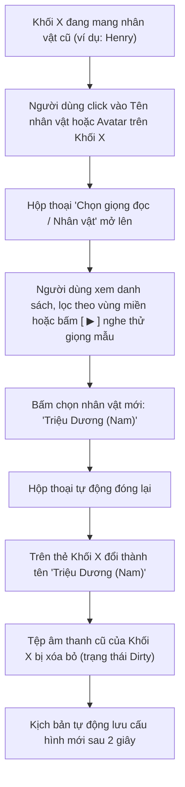
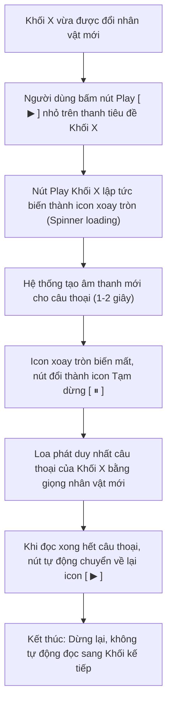
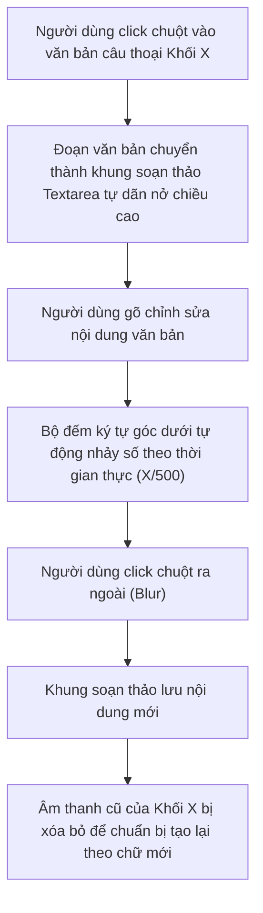
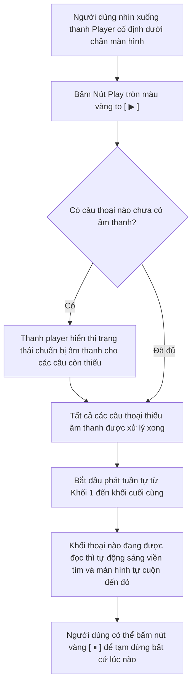
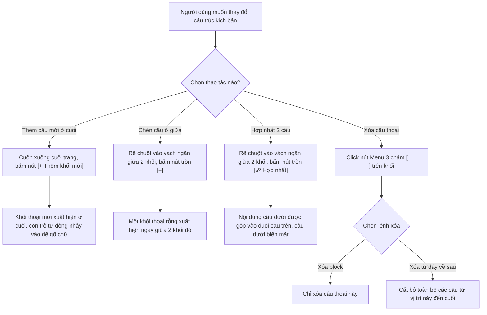
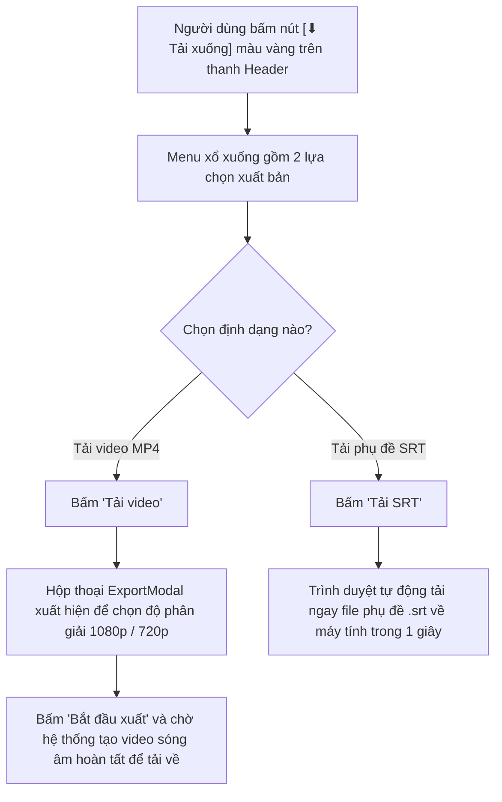

# Tổng Hợp Các Sơ Đồ User Flow Tương Tác Trong Studio (Mermaid Charts)

> **Mục đích:** Hiển thị trực quan 6 sơ đồ luồng người dùng (User Flow) tách rời bằng Mermaid để xem trực tiếp ngay trong trình đọc Markdown.

---

## 1. User Flow 1: Luồng Đổi Nhân Vật / Giọng Đọc Cho Câu Thoại

---

## 2. User Flow 2: Luồng Nghe Thử Riêng Câu Thoại (Tạo Lại Audio Riêng Đoạn)

---

## 3. User Flow 3: Luồng Soạn Thảo Văn Bản Câu Thoại

---

## 4. User Flow 4: Luồng Nghe Thử Toàn Bộ Kịch Bản (Master Play)

---

## 5. User Flow 5: Luồng Quản Lý Cấu Trúc Khối Kịch Bản (Thêm / Gộp / Xóa)

---

## 6. User Flow 6: Luồng Xuất Bản Tác Phẩm

