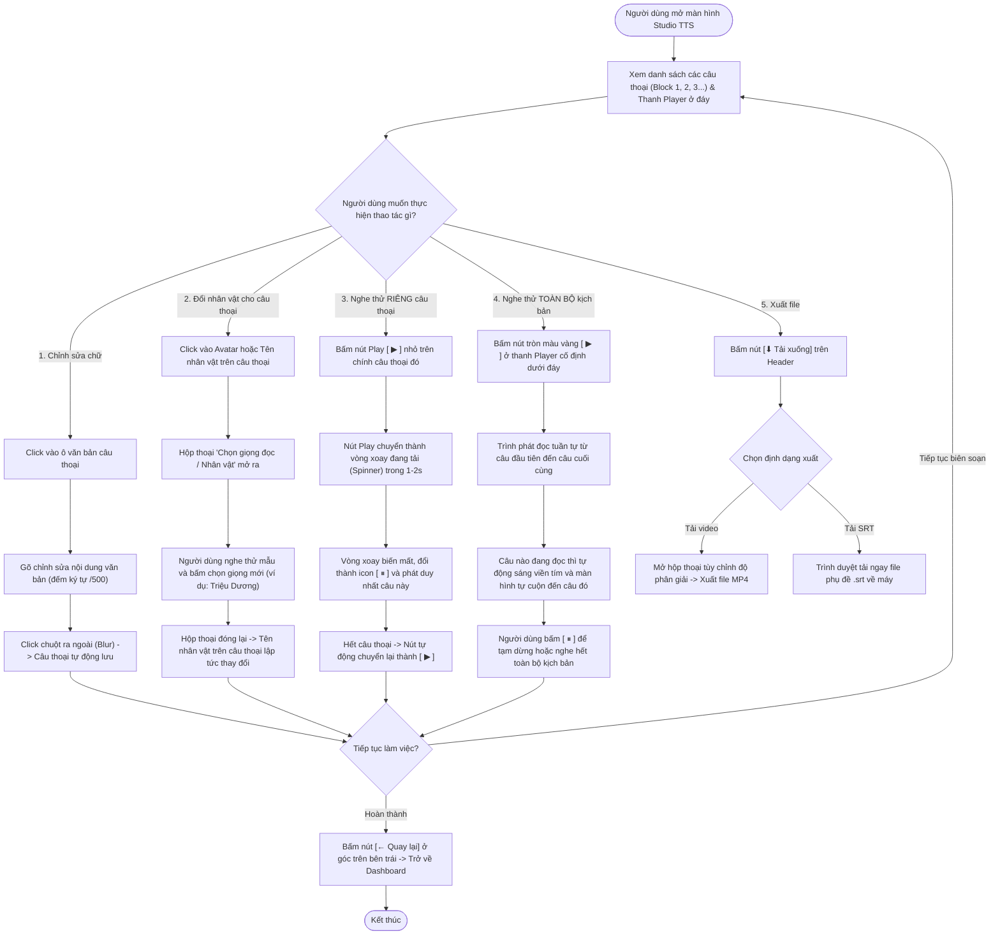
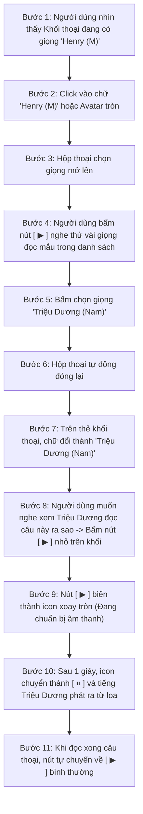
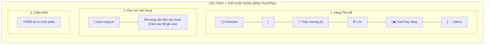

# Sơ Đồ User Flow & Hành Trình Tương Tác Của Người Dùng Trong TTS Studio (Mermaid)

> **Mục đích:** Mô tả trực quan 100% hành vi tương tác của người dùng trên giao diện Studio chuyển văn bản thành giọng nói (User Journey & Interaction Flow) mà không có bất kỳ chi tiết kỹ thuật backend nào.

---

## 1. Sơ Đồ User Flow Tổng Quan Khi Làm Việc Trong Studio

---

## 2. Sơ Đồ User Flow Chi Tiết: Hành Trình Đổi Nhân Vật & Nghe Thử Riêng Đoạn

Sơ đồ này mô tả chính xác từng thao tác của người dùng từ lúc bấm đổi nhân vật đến lúc nghe câu thoại vừa đổi:

---

## 3. Sơ Đồ Thành Phần Trực Quan Của Một Khối Thoại (VoiceoverBlock UI Mapping)

